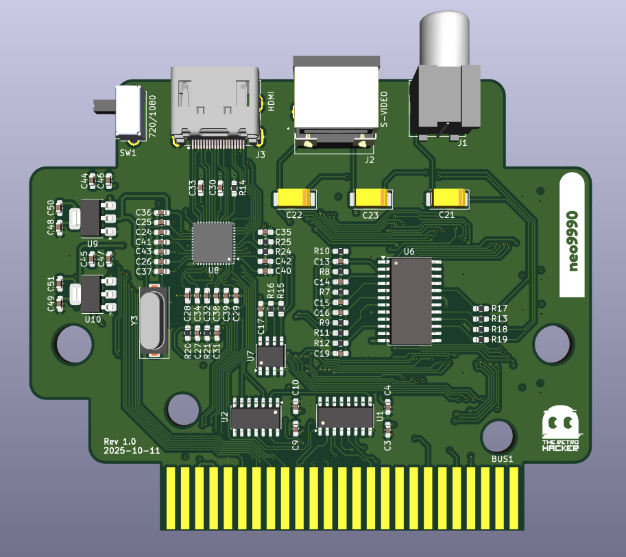
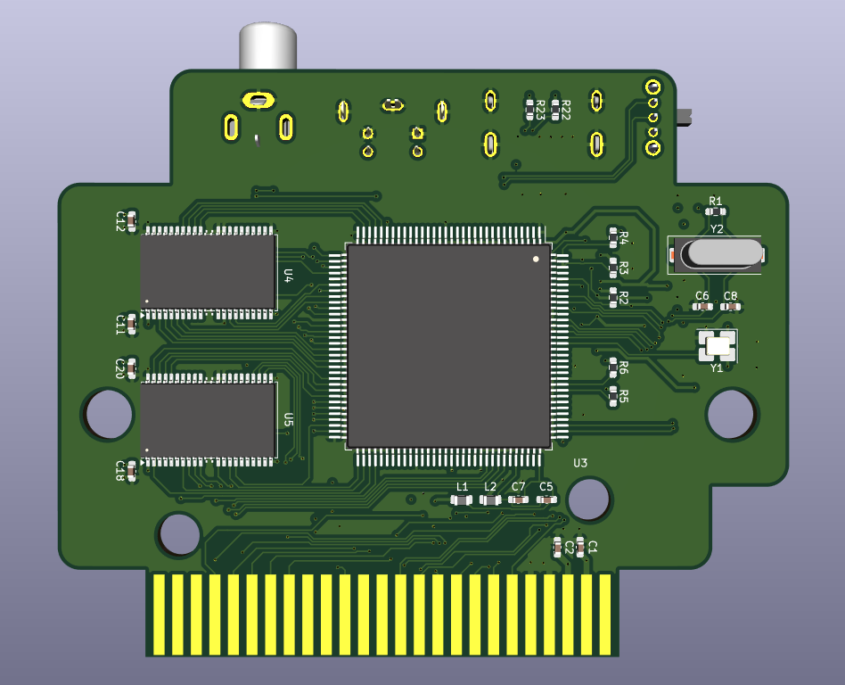
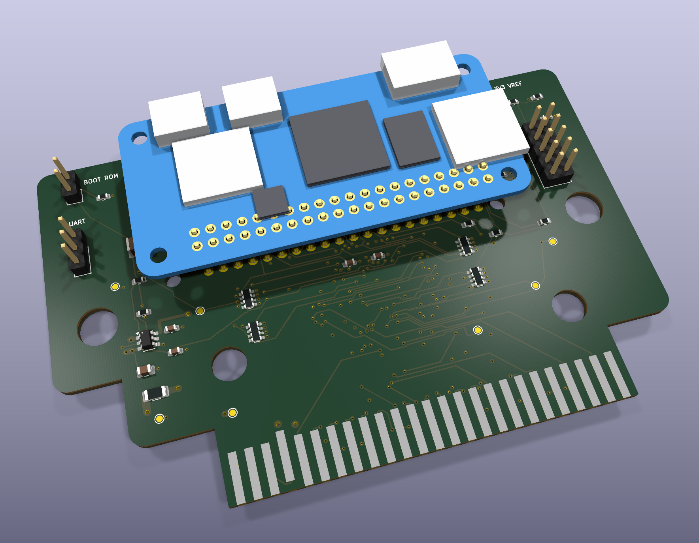
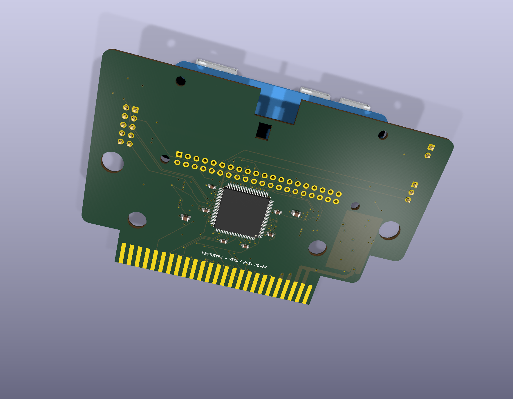
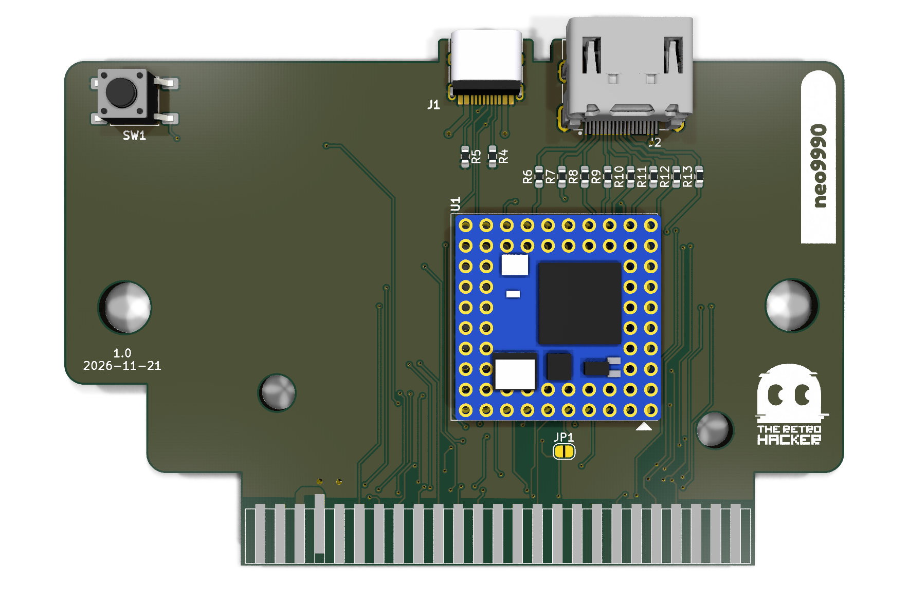
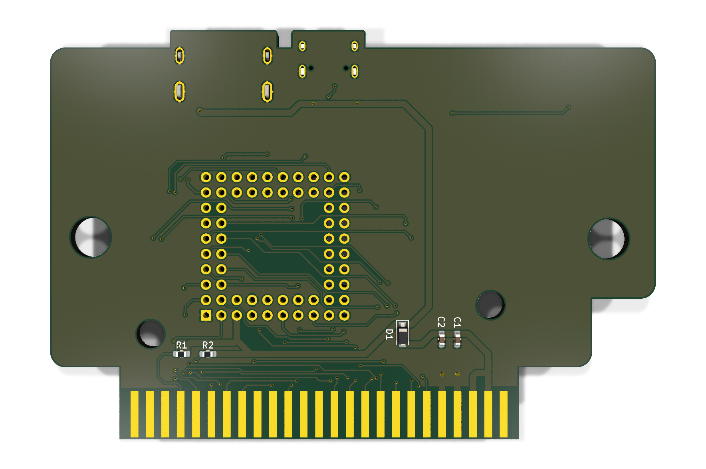

# NEO9990

**NEO9990** is an open-hardware V9990 video-cartridge project for the MSX computer system. 

## Why NEO9990?

The Yamaha V9990 (the "E-VDP III") was designed in the early 1990s for the MSX3 standard that never reached the market. Its best-known home is the Sunrise GFX9000 cartridge from 1994, which gave MSX computers 2D graphics well beyond the built-in VDP, with high-resolution bitmap and tile modes and a hardware command engine. Its software library is small, and every title depends on that one chip.

[TRH9000](https://github.com/cristianoag/trh9000) was my first step: an open-source, real-chip GFX9000-compatible cartridge, documented so that anyone can build one. It works, but it relies on the Yamaha V9990 itself, and those chips are now super rare. They have been out of production for decades, and every cartridge built consumes a part that cannot be replaced. A design that needs one chip per board cannot be reproduced by the community at any useful scale, so we were kind of forced to develop emulation hardware.

NEO9990 is the answer to that shortage. Instead of hunting for scarce silicon, the emulation boards **reproduce the V9990 in firmware** on readily available, modern hardware, keeping the MSX side as close to the original as possible: the same I/O ports (60h–6Fh), the same register model and the same VRAM behaviour. Video output is digital (HDMI/DVI) rather than 15 kHz analog RGB, so it works with current displays.

NEO9990 is an open-source project and another contribution to the MSX community from **The Retro Hacker**. Build it, improve it, port it, and share what you learn.

## Implementation tracks

This repository holds three implementation tracks, from the original real-chip design to the emulation boards that remove the dependency on the V9990 supply:

| Implementation | Approach | Status |
| --- | --- | --- |
| [Real-chip](hardware/realchip/) | Uses a Yamaha V9990 and a dedicated HDMI conversion/output stage. | Hardware design and fabrication files are published. |
| [Orange Pi](hardware/orangepi/) | Replaces V9990 hardware with V9990 emulation on an Orange Pi Zero 2W, connected to the MSX bus through a CPLD. | Prototype; backed by test firmware, HDL, and protocol software. Not a finished cartridge. |
| [Core2350B](hardware/core2350b/) | Replaces V9990 hardware with emulation on a Waveshare Core2350B (RP2350B) wired directly to the MSX bus, with HSTX HDMI/DVI output and USB-C. | Rev 1.0 schematic, routed PCB and initial tests done. V9990 firmware v1.00. |

|  |  |
|:---:|:---:|
| Real-chip board, front | Real-chip board, rear |

|  |  |
|:---:|:---:|
| Orange Pi prototype rendering, front | Orange Pi prototype rendering, rear |

|  |  |
|:---:|:---:|
| Core2350B board rendering, front | Core2350B board rendering, rear |

## Implementations in this repository

### Real-chip NEO9990

The real-chip implementation is the hardware project under [`hardware/realchip`](hardware/realchip/). It uses the Yamaha V9990 device and includes a chip-based digital-video conversion stage for HDMI output.

- [Real-chip overview](docs/realchip.md)
- [KiCad project](hardware/realchip/neo9990/neo9990.kicad_pro)
- [KiCad schematic](hardware/realchip/neo9990/neo9990.kicad_sch)
- [KiCad PCB](hardware/realchip/neo9990/neo9990.kicad_pcb)
- [Production files](hardware/realchip/neo9990/production/)
- [Interactive BOM](hardware/realchip/neo9990/bom/ibom.html)

### Orange Pi NEO9990

The Orange Pi implementation is an experimental board under [`hardware/orangepi`](hardware/orangepi/). It targets bare-metal V9990 emulation on an Orange Pi Zero 2W and uses an EPM7160STC100-10 CPLD between the MSX bus and a 16-bit parallel GPIO mailbox.

The full MSX address bus, memory request, and slot select signals are available to the host for ROM and mapper services. CPLD profiles prepare V9990, ROM, and OPL4 decoding, although the current firmware implements only a limited V9990 bring-up subset.

- [Orange Pi overview (hardware and software)](docs/orangepi.md)
- [KiCad prototype project](hardware/orangepi/neo9990/neo9990.kicad_pro)
- [Prototype restrictions and validation notes](hardware/orangepi/neo9990/prototype-notes.txt)
- [GPIO assignment](hardware/orangepi/neo9990/gpio-map.csv)
- [Prototype BOM](hardware/orangepi/neo9990/bom.csv)
- [Assembly drawings](hardware/orangepi/neo9990/plots/)
- [3D previews](hardware/orangepi/neo9990/plots/prototype-3d.png)
- [CPLD source and protocol documentation](software/orangepi/cpld/README.txt)
- [Parallel host ABI](software/orangepi/host/README.txt)
- [Bare-metal bring-up firmware](software/orangepi/firmware/README.txt)

### Core2350B NEO9990

The Core2350B implementation is under [`hardware/core2350b`](hardware/core2350b/). A Waveshare Core2350B module is wired directly to the MSX slot without voltage translation, outputs HDMI/DVI from the RP2350 HSTX pins, and is programmed over USB-C. The board outline, edge connector and USB-C wiring come from the PicoVerse 2350 board.

Rev 1.0 has a finished schematic and a routed PCB, and initial tests have been done. The V9990 firmware builds with `make` from `software/core2350b/v9990`; the UF2 file is in [`firmware/`](firmware/).

- [Core2350B hardware](docs/core2350b-hardware.md)
- [Core2350B firmware](docs/core2350b-firmware.md)
- [KiCad project](hardware/core2350b/neo9990/neo9990.kicad_pro)
- [GPIO assignment](hardware/core2350b/neo9990/gpio-map.csv)

## Documentation

The explanatory documents for every implementation are in [`docs/`](docs/index.md).

## Repository layout

```text
docs/          documentation for each implementation
firmware/      ready-to-flash Core2350B firmware images (UF2)
hardware/
  realchip/    Yamaha V9990 implementation and HDMI conversion/output hardware
  orangepi/    Orange Pi Zero 2W / CPLD prototype
  core2350b/   Waveshare Core2350B (RP2350B) implementation
software/
  orangepi/    CPLD, host protocol, and firmware tests/supporting software
  core2350b/   V9990 firmware for the Core2350B board
```

Each implementation keeps its own hardware and implementation-specific software. Files under `software/orangepi` are the supporting prototype software for `hardware/orangepi`; they are not firmware for the real-chip board or the Core2350B board.

## Contributing

Contributions are welcome through issues and pull requests. Keep changes scoped to the correct implementation directory and state clearly whether they affect the real-chip board, the Orange Pi prototype, or a future track.

Hardware changes should include the corresponding fabrication/CAD outputs when applicable. Prototype software and HDL changes should include focused tests and should not claim unverified board-level operation.

## Third-party notices and references

The NEO9990 Core2350B firmware (`software/core2350b`) builds on the work below.
Source files that derive from it say so in their header comment.

* **Yamaha V9990 behaviour: openMSX**: Where the Yamaha V9990 Application Manual is silent, the V9990 core follows the
behaviour of openMSX (`src/video/v9990`, <https://github.com/openMSX/openMSX>), which is released under the GNU General Public License v2.

* **DVI output: pico-examples**: `common/dvi_out.c` is derived from the HSTX DVI example in <https://github.com/raspberrypi/pico-examples>. Copyright 2020 (c) Raspberry Pi (Trading) Ltd.


## License

This project is licensed under the [Creative Commons Attribution-NonCommercial-ShareAlike 4.0 International License](http://creativecommons.org/licenses/by-nc-sa/4.0/).

- You may remix and adapt the material with proper attribution.
- Derivative works must be shared under the same license.
- Commercial use is not permitted without explicit authorization.

See [LICENSE.txt](LICENSE.txt) for the complete license text.

The Orange Pi firmware and shared host protocol header are separately licensed under **GPL-2.0-only**. See the [firmware license and notices](software/orangepi/firmware/COPYING) and [openMSX provenance](software/orangepi/firmware/third_party/openmsx/PROVENANCE.txt).


